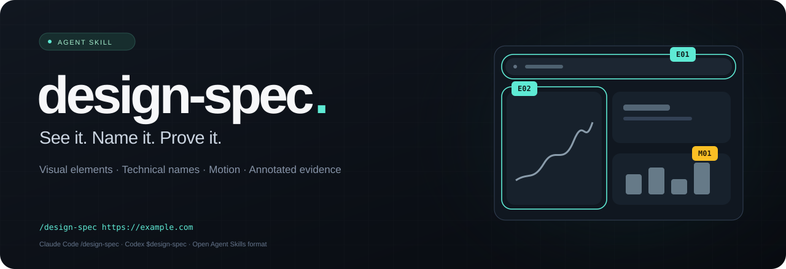
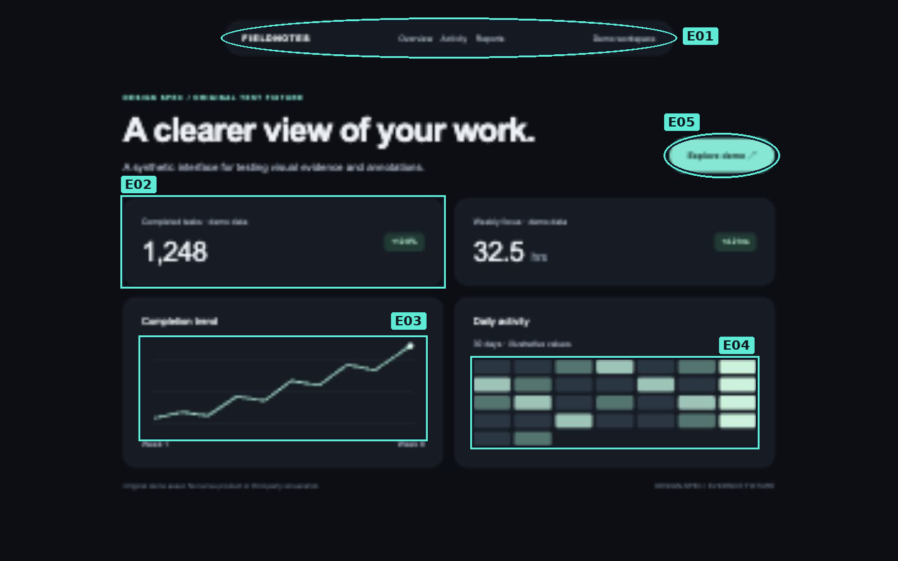

<p align="center">
  
</p>

<p align="center">
  <a href="LICENSE"></a>
  <a href="https://agentskills.io"></a>
  <a href="https://github.com/viniwolff15764-gif/design-spec/actions/workflows/validate.yml"></a>
  <a href="README.pt-BR.md"></a>
</p>

<h3 align="center">A visual inventory you can point to.</h3>
<p align="center">Real technical names. Measured specs. Numbered screenshots.<br>One reusable skill for understanding a website's design and motion.</p>

---

```text
/design-spec https://example.com
```

**Design Spec** teaches your AI agent to inspect a live website, identify its visual elements and animations, and show exactly which name belongs to which detail.

It separates **what the element is**, **how it is styled**, **how it moves**, and **what the implementation actually proves**. Every finding connects to evidence. Uncertainty stays visible.

> Claude Code uses `/design-spec URL`. Codex uses `$design-spec URL`.
> The workflow is portable; invocation syntax belongs to each agent.

## See the output

<p align="center">
  
</p>

| Mark | Technical name | What it identifies |
|:--|:--|:--|
| **E01** | Pill-shaped navigation | The capsule-shaped navigation bar |
| **E02** | Metric card | A prominent value with supporting context |
| **E03** | Line chart | A trend encoded by connected points |
| **E04** | Calendar heatmap | Day-level activity encoded by intensity |
| **E05** | Pill-shaped button | The rounded primary action |
| **M01** | Scale transition | The button's observed hover transformation |

*Original synthetic demo, captured in a browser. This is an output example, not an audit of a third-party product. [View the example report](examples/sample-report/report.md).*

## What you get

| Deliverable | Contents |
|:--|:--|
| **Visual atlas** | Actual screenshots with numbered circles, boxes and matching legends |
| **Complete scoped inventory** | Elements, patterns, styles, treatments and meaningful variants |
| **Motion inventory** | Triggers, before/after evidence, changed properties, repetition and verified timing |
| **Measured specifications** | Typography, colors, spacing, radii, borders, shadows and responsive differences |
| **Coverage ledger** | Inspected routes, sections, states and explicit gaps |
| **Portable files** | Markdown report, JSON inventory, originals and annotated images |

The checklist covers layout, navigation, UI components, typography, imagery, illustration, data visualization, surface effects, responsive changes and motion. There is no arbitrary "top ten" cutoff.

## Install

### With the Skills CLI

```sh
npx skills add viniwolff15764-gif/design-spec --skill design-spec
```

Select your agent when prompted. Add `-g` for a personal installation across projects. The Skills CLI has its own Node.js requirement; see its [documentation](https://github.com/vercel-labs/skills).

### Without Node.js

Requires Python 3.10+ and Git:

```sh
git clone https://github.com/viniwolff15764-gif/design-spec.git
cd design-spec
python3 install.py
```

This installs the skill for **Claude Code** and **Codex**, without changing agent settings or installing a browser. On Windows, use `python` or `py -3` instead of `python3`.

```sh
# Install only for one agent
python3 install.py --agent claude-code
python3 install.py --agent codex

# Install into a project
python3 install.py --project /path/to/project

# Preview without writing
python3 install.py --dry-run

# Another Agent Skills-compatible tool: exact destination folder
python3 install.py --agent generic --target /path/to/skills/design-spec
```

The installer refuses to overwrite differing existing files. An identical installation is a no-op.

## Use

| Environment | Invocation |
|:--|:--|
| **Claude Code** | `/design-spec https://example.com` |
| **Codex** | `$design-spec https://example.com`, or select it through `/skills` |
| **Other Agent Skills hosts** | Install the folder and use the host's skill invocation |
| **Agents without native skills** | Ask the agent to read `skills/design-spec/SKILL.md` and audit a URL |

You can add natural-language scope:

```text
/design-spec https://example.com
Include desktop and mobile. Explain everything in Portuguese.

/design-spec https://example.com
Inspect the entire public site, grouping repeated page templates.
```

The default covers the supplied page, its sections and safely observable states at desktop and mobile sizes. A whole-site request expands to distinct accessible page templates with an explicit route ledger.

## The evidence rules

**No invented names.** Established terminology is distinguished from literal descriptions and uncertain classifications.

**No animation from a still.** Motion requires witnessed behavior plus multiple frames or a recording.

**No guessed numbers.** Exact timings, easing, font identity and dimensions need a measurement source.

**No invisible annotations.** Every item links to a screenshot marking its actual location.

**No false completeness.** Hidden pages, login walls, experiments, inaccessible states and unsupported tools remain documented limits.

A rotated phone is not automatically isometric. A dark card is not automatically glassmorphism. A progress ring is not automatically a donut chart.

## Tools and portability

This is an **instruction-based skill**, not a standalone crawler. The host agent supplies vision, browser access and permissions. It works with documented browser/MCP/computer-use tools instead of depending on a single vendor.

- **Visual browser access:** required for a live audit.
- **DOM/CSS access:** optional; improves measurement precision.
- **File access:** needed for the full report folder.
- **Python + Pillow:** needed for the bundled annotation and image-validation helpers.
- **No browser or vision:** the agent reports the limitation and can work from supplied screenshots, with reduced scope.

Native installation and command behavior are documented for Claude Code and Codex. Other agents can consume the open skill format or its Markdown instructions, but their tool capabilities and command syntax vary. This repository does not claim every agent/version has been tested.

## Inside the skill

```text
skills/design-spec/
├── SKILL.md                    Workflow and evidence rules
├── agents/openai.yaml          Codex discovery metadata
├── references/
│   ├── inspection.md           Coverage checklist
│   ├── terminology.md          Real names and common confusions
│   ├── motion.md               Motion observation protocol
│   ├── output.md               Report and annotation contracts
│   └── probe.md                Optional DOM inspection guide
└── scripts/
    ├── annotate.py             Draw IDs on screenshot copies
    ├── probe.js                Read-only style/animation sampler
    └── validate_report.py      Check evidence and annotation links
```

The annotation helper needs `Pillow>=10.4`. If needed and permitted by the host, the agent provisions an isolated environment inside the audit work directory; no global Python changes are required. The skill tells the agent to use existing native annotation tools when appropriate. The probe does not read cookies, storage or form values.

## Development

```sh
python3 -m pip install -r requirements-dev.txt
python3 -m unittest discover -s tests -v
python3 scripts/check_package.py
```

Tests cover annotation bounds, original preservation, installation conflicts, evidence references and motion-frame requirements. CI runs these checks on Linux, macOS and Windows. Structural validation does not certify that an AI's design interpretation is correct.

See [the evaluation scenarios](tests/behavioral-evals.md) for behavioral acceptance criteria.

## References

[Agent Skills specification](https://agentskills.io/specification) ·
[Claude Code skills](https://code.claude.com/docs/en/skills) ·
[Codex skills](https://developers.openai.com/codex/skills/) ·
[Skills CLI](https://github.com/vercel-labs/skills)

## License

[MIT](LICENSE). Created by [Vinicius Wolff](https://github.com/viniwolff15764-gif).

The license covers this skill and its original demo assets. Auditing a website does not transfer rights to that website's images, trademarks or code.
