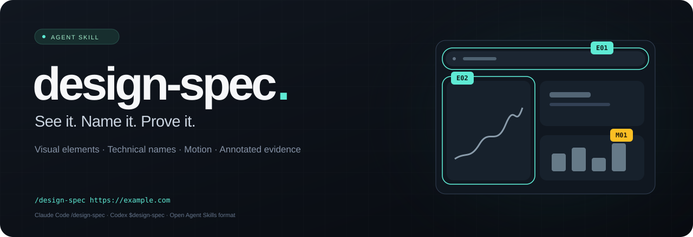
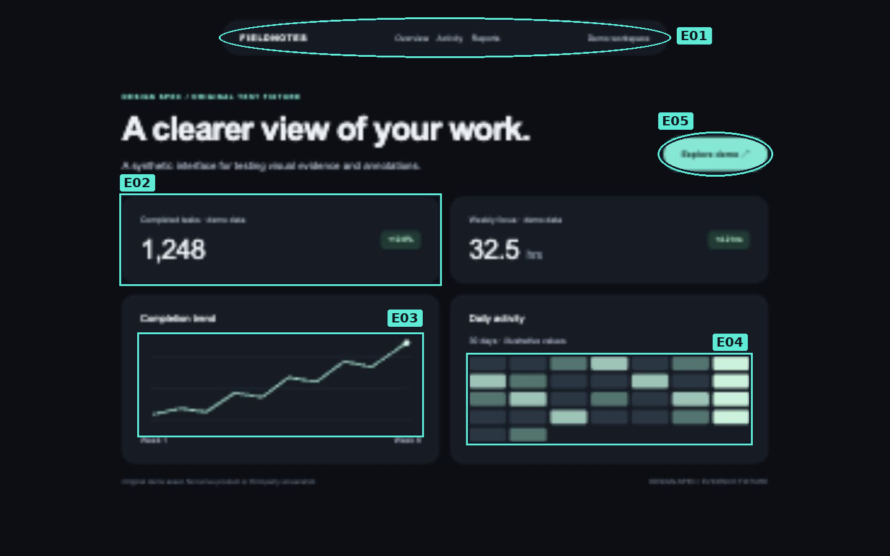

<p align="center"></p>

# Design Spec

**Descubra o nome de cada detalhe de um site, com prints mostrando qual é qual.**

Uma skill que orienta agentes de IA a inspecionar sites, identificar elementos visuais e animações e entregar um inventário técnico com evidências. A resposta vem no idioma do usuário, preservando os nomes técnicos em inglês.

[English documentation](README.md) · [Exemplo de relatório](examples/sample-report/report.md) · [Licença MIT](LICENSE)

## Instalação rápida

```sh
npx skills add viniwolff15764-gif/design-spec --skill design-spec
```

Selecione o agente. Acrescente `-g` para instalar globalmente.

Sem Node.js, com Python 3.10+:

```sh
git clone https://github.com/viniwolff15764-gif/design-spec.git
cd design-spec
python3 install.py
```

O instalador copia a skill para Claude Code e Codex. Não modifica configurações nem sobrescreve uma instalação diferente. No Windows, use `python` ou `py -3`.

## Como chamar

**Claude Code**
```text
/design-spec https://example.com
```

**Codex**
```text
$design-spec https://example.com
```

A sintaxe depende do aplicativo. No Codex, também é possível selecionar a skill por `/skills`. Outros agentes compatíveis com Agent Skills podem carregar a mesma pasta. Um agente sem suporte nativo pode ler o SKILL.md como instruções, desde que tenha as ferramentas necessárias.

## Mais rápida e econômica na versão 1.1

O padrão passa a ser uma **meta de 5 minutos por página**, incluindo a entrega. A skill reutiliza capturas, agrupa componentes repetidos por variante, evita consultas enormes e gera prints marcados e relatório a partir de um único inventário.

- Uso normal: `/design-spec URL`.
- Mais tempo para cobertura extensa: `/design-spec URL --deep`.
- Outro orçamento: `/design-spec URL --budget 180` (segundos).
- No Codex, use `$design-spec` com os mesmos argumentos.

Os critérios de nomenclatura e evidência continuam. A meta não é um limite imposto pelo programa: depende do agente, ferramentas e tamanho do site. O que não couber fica explícito como não inspecionado. Não prometemos a mesma cobertura integral de qualquer site em 5 minutos.

**Medições:** o probe compacto reduziu em 85% os bytes de saída num teste sintético com estilos repetidos, preservando os valores coletados. O gerador produziu três prints marcados e um relatório com seis itens em 0,435 s na VPS, sem contar navegação ou raciocínio. Isso não equivale a 85% de desconto na conta nem mede a duração real no Claude Code. [Método e limites](docs/performance.md).

## O que recebe

- Lista numerada dos elementos, estilos, tratamentos e animações observáveis.
- Prints com círculos, caixas e IDs correspondentes aos itens da lista.
- Evidências antes/depois para os movimentos.
- Especificações medidas: cores, tipografia, espaçamento, bordas e sombras.
- Diferenças entre desktop e celular.
- Relatório Markdown, inventário JSON e imagens, quando houver acesso a arquivos.
- Cobertura explícita: o que foi inspecionado e o que ficou inacessível.



## Nomes reais, evidências reais

A skill separa:
- **Elemento:** notification banner, calendar heatmap, device mockup.
- **Tratamento:** outer glow, rounded corners, monochromatic palette.
- **Movimento:** fade, scale transition, scroll-linked translation.
- **Implementação:** apenas quando inspecionada, como `position: sticky`.

Ela distingue termos estabelecidos de descrições e classificações incertas. Não inventa uma categoria porque algo parece "premium", não chama todo celular inclinado de isométrico e não presume animação a partir de um print.

## Limites honestos

A skill usa o navegador e a visão do próprio agente. Não instala nem inclui um navegador. DOM/CSS melhora as medições; Python e Pillow permitem gerar as marcações. Sem esses recursos, informa a limitação.

Por padrão, cobre a URL fornecida e seus estados observáveis. Peça "o site inteiro" para incluir diferentes páginas e modelos públicos. Nenhuma inspeção pode garantir todos os estados privados, testes A/B, rotas ocultas ou combinações possíveis.

Veja opções de instalação, testes e estrutura no [README completo](README.md).
