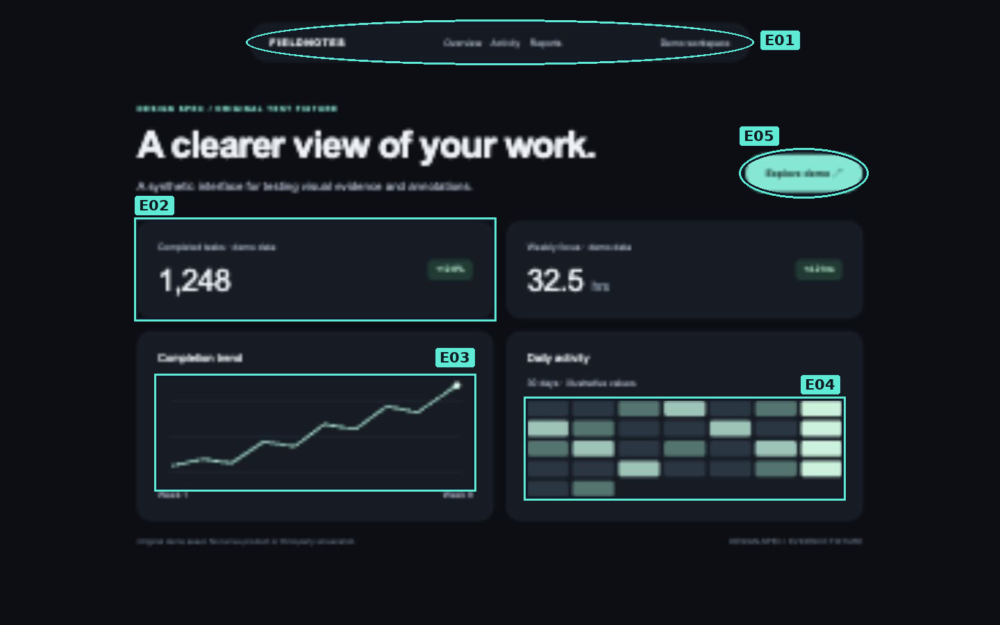
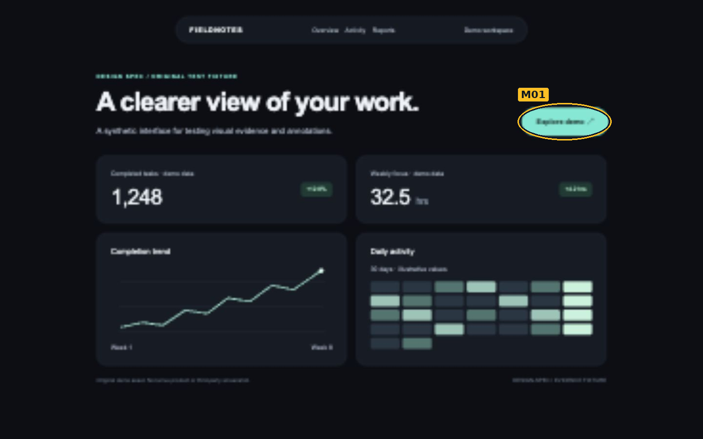

# Design Spec · example output

**Scope:** five selected visual elements and one hover effect from the repository's original synthetic fixture. This is an intentionally limited output example, not a full-site audit.

**Evidence:** browser captures at 1440 × 900 CSS pixels. The capture tool introduced some text softness; this does not support font-rendering judgments. Original image files are preserved.

## Numbered visual atlas

| ID | Technical name | Meaning | Term classification | Evidence |
|---|---|---|---|---|
| E01 | Pill-shaped navigation | Navigation enclosed in a capsule shape | Descriptive | S01 |
| E02 | Metric card | A large value with context and a delta | Established | S01 |
| E03 | Line chart | Connected points encode a trend | Established | S01 |
| E04 | Calendar heatmap | Day-level values encoded by fill intensity | Established | S01 |
| E05 | Pill-shaped button | A capsule-shaped action button | Descriptive | S01 |

## Motion: M01 · Scale transition

The button expands from scale(1) to scale(1.06) on pointer hover. The browser's computed style reports a **240 ms ease-out transform transition**. This is the declared CSS transition, not an independent measurement of frame-by-frame effective playback. No spring behavior is claimed.

| Before | After |
|---|---|
|  |  |

- Trigger: pointer hover. The testing tool placed the pointer on the no-op demo button using a click.
- Changed property: transform.
- Repetition: on pointer entry/exit.
- Reduced motion: not tested in this sample.
- Runtime evidence: [captured computed style](evidence/motion-style.json).

## Specifications

| Item | Property | Value | Source |
|---|---|---|---|
| E01 | Shape | Capsule / fully rounded ends | Observed screenshot |
| E02 | Border radius | 20 px | Fixture CSS; consistent with visible card |
| E02 | Fill | #151b25 | Fixture CSS |
| E03 | Encoding | Line position | Observed chart |
| E04 | Encoding | Cell fill intensity | Observed chart and fixture labels |
| E05 | Transition | transform 240ms ease-out | Computed style in browser |
| M01 | Hover transform | matrix(1.06, 0, 0, 1.06, 0, 0) | Computed style in browser |

## Coverage and limits

Inspected: selected desktop components; default and hover states of the button.

Not included in this scoped sample: a complete element census, mobile layout, keyboard focus state, reduced-motion emulation, entry/exit animations, alternate routes and production data.

The full skill requires these relevant categories to be inspected or recorded as limits. Do not use the brevity of this example to truncate a real audit.

## Files

- [Machine-readable inventory](inventory.json)
- [Original default screenshot](evidence/S01-original.jpg)
- [Original hover screenshot](evidence/S03-original.jpg)
- [Original fixture source](../fixture.html)

All images in this example were generated from the project's original demo, not copied from another product.
